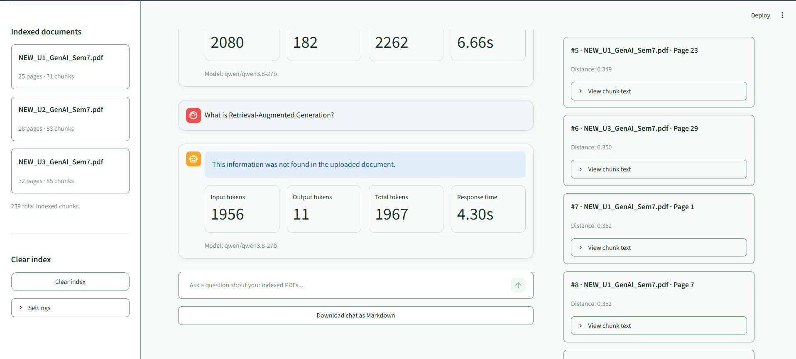
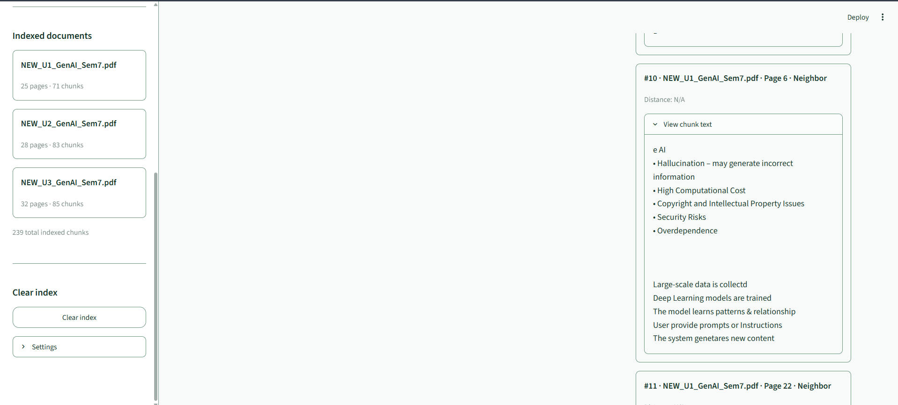
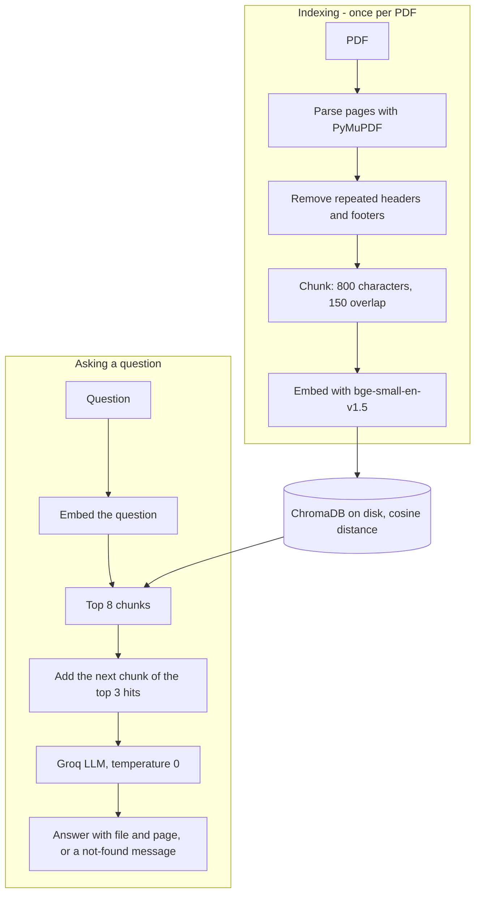
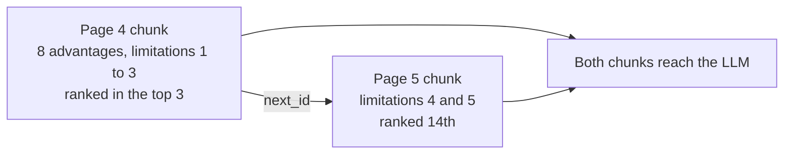
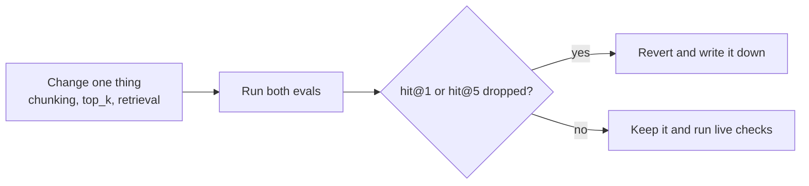

<div align="center">

# DocMind

**Ask questions about your PDFs and get answers with the file and page they came from.**
If the documents do not contain the answer, DocMind says so instead of guessing.


A small retrieval-augmented generation (RAG) app, built to learn how retrieval quality is actually measured, and where it breaks.

</div>

---

## Contents

[Screenshots](#screenshots) · [At a glance](#at-a-glance) · [Architecture](#architecture) · [How it works](#how-it-works) · [Evaluation](#evaluation) · [What the evals changed](#what-the-evals-changed) · [Known limitations](#known-limitations) · [Quick start](#quick-start) · [Project structure](#project-structure) · [Cost and speed](#cost-and-speed) · [Roadmap](#roadmap-not-built-yet)

---

## Screenshots

| Answer with a file and page citation | Refusal when the answer is not in the documents |
|---|---|
|  |  |



The right-hand panel shows the chunks that were sent to the model. These are not the same thing as the pages the model cites; the citation is inside the answer text.

---

## At a glance

| | Result |
|---|---|
| Retrieval on one 25-page PDF (23 answerable questions, top 5) | hit@5 **23/23**, hit@1 **18/23** |
| Retrieval on three PDFs, 239 chunks (20 answerable questions, top 8) | hit@8 **20/20**, hit@1 **17/20** |
| Lists that continue on the next page (5 questions) | every expected page retrieved in **4 of 5** (2 of 5 before neighbour chunks) |
| Speed on an 8 GB RAM, Intel i3 laptop without a GPU | about **1 s** per question once the app is running, about 15 s for a normal start |
| LLM tokens per question | about 1,500 to 2,300 |

These numbers come from question sets I wrote while looking at the PDFs, so expect lower scores on unseen questions. See [Evaluation](#evaluation).

---

## Architecture



---

## How it works

1. **Parsing.** PyMuPDF reads each PDF page by page. Lines that repeat on at least half of the pages (headers, footers, page numbers) are removed. Pages without text trigger a warning, because there is no OCR.
2. **Chunking.** Each page is cut into chunks of 800 characters with 150 overlap. The first chunk of a page also carries the last 300 characters of the previous page, so a list that crosses a page break stays together. Every chunk stores its file, its page, and the id of the next chunk (`next_id`).
3. **Indexing.** Chunks are embedded locally with `BAAI/bge-small-en-v1.5` and stored in a persistent ChromaDB folder (`data/chroma`), so each PDF is indexed once.
4. **Retrieval.** The question is embedded and the 8 closest chunks are taken. The next chunk of the 3 best hits is then appended after them as a *neighbour*. The ranking is not changed by this.
5. **Answering.** The chunks go to a Groq-hosted model with the instruction to answer only from the context, cite the file and page, and otherwise reply "This information was not found in the uploaded document." Temperature is 0.
6. **Interface.** Streamlit shows the answer, token usage, response time, and the chunks that were sent to the model, with neighbour chunks marked.

**Why neighbour chunks:** a list that starts on one page and ends on the next can be cut in half by chunking.



---

## Evaluation

Two retrieval-only evals (no LLM calls, so they cost no tokens) run after every change:

```powershell
python eval/run_eval.py path\to\one.pdf
python eval/run_eval_multi.py a.pdf b.pdf c.pdf --top_k 8 --expand 3
```

- `hit@k`: an expected page is among the top k chunks.
- `complete@k`: for answers that span several pages, every expected page is among the retrieved chunks. This catches answers that look complete but are not.



### One PDF (`eval/questions.json`: 23 answerable, 9 not answerable)

| Configuration | hit@5 | hit@1 |
|---|---|---|
| 1500 characters, 200 overlap | 22/23 | 17/23 |
| 800 characters, 150 overlap | 22/23 | 19/23 |
| 800 / 150 + header and footer removal | 23/23 | 19/23 |
| + tail of the previous page (**kept**) | 23/23 | 18/23 |
| + head of the next page as well (**reverted**) | 23/23 | 12/23 |

The first two rows were recomputed by hand from the printed pages after I corrected one expected-page label.

### Three PDFs, 239 chunks (`eval/questions_multi.json`: 25 questions, top 8)

| Question group | Questions | hit@8 | hit@1 | complete@8 |
|---|---|---|---|---|
| English, answerable | 16 | 16/16 | 13/16 | 2/4, **3/4** with neighbour chunks |
| Hinglish, answerable | 4 | 4/4 | 4/4 | 1/1 |

### Why there is no distance threshold for refusing

| Kind of question | Best-match distance (lower is closer) |
|---|---|
| Answerable | 0.11 to 0.46 |
| On a related topic, but not in the documents | 0.30 to 0.36 |
| Unrelated, English | 0.53 to 0.58 |
| Unrelated, Hinglish | 0.43 |

No single number separates these groups, so refusing is left to the LLM instruction. In hand-run checks (Groq, temperature 0) questions about retrieval-augmented generation, LSTMs, and blockchain were refused correctly. That is a small sample, not a guarantee.

---

## What the evals changed

| Change | Effect |
|---|---|
| Header and footer removal | hit@5 22/23 to 23/23 on the one-PDF eval |
| Chunks 1500 to 800 characters | hit@1 17/23 to 19/23 |
| Tail of the previous page carried into the next chunk | a list answered with 7 of 11 items now returns all 11 |
| `top_k` 5 to 8 | needed for a table row that ranked 6th; about 47% more tokens on that question |
| Neighbour chunks | complete@8 2/4 to 3/4, hit@1 unchanged by construction |

| Question | Before | After |
|---|---|---|
| Advantages and limitations of open-source AI | 11 advantages (3 from another list) and 5 limitations, 2 of them from an unrelated page | exactly 8 and 5, pages 4 and 5 |
| Stages of dataset management | 7 of 11 stages | 11 of 11 |
| What is LoRA? | one True/False sentence | the table description ("small trainable matrices"), found at top 8 |

<details>
<summary><b>Experiments that did not work</b></summary>

- **Also embedding the head of the next page into a page's last chunk.** hit@5 stayed at 23/23 but hit@1 fell from 18/23 to 12/23: text from page N+1 stored under page N's label pulled queries to chunks with the wrong page label. Reverted. Neighbour chunks do the same job without touching the embedded text.
- **A distance threshold to refuse unrelated questions.** Impossible with these distances (see the table above).
- **BGE-M3 embeddings.** Too heavy for an 8 GB laptop, so the smaller bge-small model stays.

</details>

---

## Known limitations

- **Definitions two chunks away.** A question about model-compression techniques returns all 5 technique names but no definitions for the last two, because that chunk is two hops from the retrieved ones.
- **Rare acronyms.** "What is LoRA?" needed top 8 to find the right chunk (it ranked 6th). There is no keyword or hybrid search.
- **Noise from quiz pages.** Multiple-choice pages sometimes appear among the top results.
- **A cited page can be wrong**, for example for text carried over from the previous page. Citations are not checked automatically.
- **Answers are in English** even when the question is in Hinglish; the prompt has no language rule.
- **No chat memory.** Every question is answered independently.
- **No OCR.** Scanned PDFs give no text; the app shows a warning.
- **English embedding model**, and PDFs only.
- **Test data.** Evals use three course PDFs (25, 28 and 32 pages) that are not included here. The question files are tied to them.
- **Slow first start.** On my laptop the first start after boot took between 90 and 290 seconds (model load); later starts took about 15 seconds.

---

## Quick start

```powershell
git clone https://github.com/daxpatel7/DocMind.git
cd DocMind
python -m venv .venv
.venv\Scripts\Activate.ps1
pip install -r requirements.txt
Copy-Item .env.example .env
streamlit run app.py
```

On macOS or Linux use `source .venv/bin/activate` and `cp .env.example .env`.

1. Edit `.env` and set `GROQ_API_KEY` and `LLM_MODEL` (tested with `qwen/qwen3.8-27b`). The key is never committed.
2. The first run downloads the embedding model (about 130 MB) from Hugging Face. After that it also works offline.
3. Upload PDFs in the sidebar and press **Index PDFs**. The index is saved in `data/chroma`.
4. After changing chunking or the embedding model, press **Clear index** and index the PDFs again.
5. The Streamlit file watcher is switched off in `.streamlit/config.toml`, so restart the app after code changes.

---

## Project structure

<details>
<summary><b>Show files</b></summary>

```text
DocMind/
├── app.py                  Streamlit UI and answer generation
├── rag_core.py             parsing, chunking, retrieval (no Streamlit imports)
├── eval/
│   ├── questions.json          one-PDF question set
│   ├── questions_multi.json    three-PDF question set
│   ├── run_eval.py             retrieval eval for one PDF
│   └── run_eval_multi.py       retrieval eval for several PDFs
├── debug_index.py          inspect what the saved index returns for a question
├── debug_query.py          same, but builds a temporary index from PDFs
├── test_neighbors.py       shows neighbour chunks for a question
├── .streamlit/             theme and Streamlit settings
├── docs/screenshots/       images used in this README
├── requirements.txt
└── .env.example
```

</details>

---

## Cost and speed

| | |
|---|---|
| Embeddings | local, free, CPU only |
| LLM | Groq API; about 200K tokens per day on the model limit I saw in the Groq console (limits can change) |
| Tokens per question | about 1,500 to 2,300, so roughly 100 questions per day |
| Evals | 0 LLM tokens |
| Warm question | about 1 s, measured in the app |

---

## Roadmap (not built yet)

- Neighbours of neighbours (two hops) for definitions that sit two chunks away
- Keyword plus vector (hybrid) search for acronyms
- A check that warns when the cited page was not among the retrieved chunks
- The answer in the language of the question
- Search inside one chosen document
- A reranker, after measuring its memory cost on a small laptop
- OCR and DOCX support
- An API layer, so the interface can be swapped

---

Built by Dax as an AI/ML internship learning project.